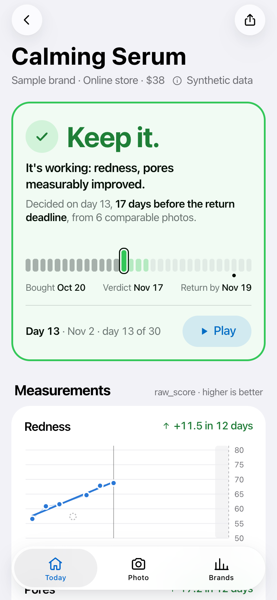
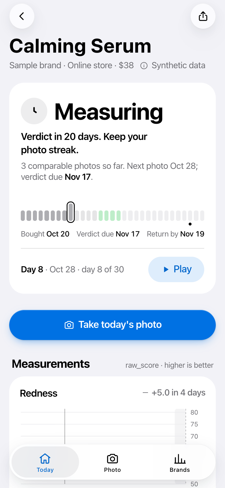
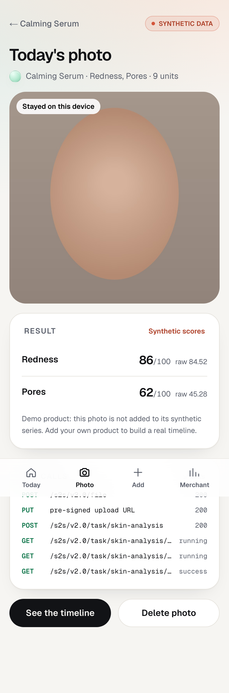

# Verdict

**Know if a skincare product works before the return window closes.**
Verdict reads what a product promises, measures only those concerns with **YouCam AI Skin Analysis** in comparable
photos, and tells you **keep it, return it, or stop using it**, two days before the return deadline.

Built for the *YouCam API Skin AI & eCommerce VTO Hackathon* (2026). Mobile-first web app (Next.js).

<p>
  
  
  
</p>

## Try it in 10 seconds

1. Open the app: the first card is a serum whose verdict landed on day 13 (Nov 2), **17 days before the deadline**, from 6 comparable photos.
2. Tap **Replay the 30-day return window**: every day is recomputed from the photos available that day, and you
   watch "Measuring" turn into "Keep it".
3. Open the shelf: one product per outcome (keep, return, stop, still measuring).
4. **Take a photo** → consent → camera (or *Use a sample*) → on-device quality gate → analysis, with every YouCam API
   call listed.
5. **Add** a product (the + button): scan the bottle (the label and its promise are read from the photo) or paste the
   claim; Verdict picks the concerns and prices the whole window in units before the first photo.
6. **Try**: when the answer is return it, try a makeup look, a hairstyle or an outfit on your own photo with YouCam
   virtual try-on.
7. **How it works** (`/agent`): every YouCam call Verdict makes, in order, with its cost.

On a computer, open `/phone` to use the app inside an iPhone frame. Light and dark mode follow the system.

> **Two kinds of data, always labelled.** The demo shelf (four products, 30-day story) is **synthetic**: scores are
> generated in the exact shape of the documented Skin Analysis response, and every screen says "Synthetic data".
> A photo you take is analysed live only when
> the deployment allows it and the unit guard agrees; otherwise it runs in demo mode, never leaves your device, and
> the screen says why.

## What it does

- **Reads the promise.** "Calming serum that reduces redness and refines pores in 14 days" → *redness, pores*,
  14 days. Tracking 1 to 4 concerns keeps every photo in the cheapest SD tier (9 units).
- **Makes photos comparable.** An on-device gate (light, face size, resolution, lighting drift vs day 0) runs before
  any unit is spent. Photos that differ are set aside, not averaged in.
- **Decides on a trend, not a photo.** Least-squares slope on `raw_score` with a noise floor; `ui_score` is shown but
  never trended, because the provider calibrates it upward on purpose.
- **Decides in time.** Daily photos in the final 4 days, verdict at the latest 2 days before the deadline (earlier when every promised concern clearly improves). Irritation-type concerns
  getting worse trigger **Stop** at once. A promise longer than the return window (retinol: 12 weeks vs 30 days) is
  flagged.
- **Proof for the store.** A printable report of every photo, its quality and its scores.
- **Merchant view.** Measured efficacy per SKU, return rate, and claims that over-promise.

## YouCam APIs

| API | Use in Verdict | Cost | Status |
| --- | --- | --- | --- |
| **AI Skin Analysis** (`/s2s/v2.0/task/skin-analysis`, `format: json`) | Scores for the 1 to 4 promised concerns | 9 units (SD, 1–4 concerns) | live |
| File API (`POST /s2s/v2.0/file` + PUT to the pre-signed URL) | Upload, then poll the task until `success` | free | live |
| **Skin Simulation** (`/s2s/v2.0/task/skin-simulation`) | "The promised result" on the photo just analysed, reusing its `file_id` | 4 units (1–4 concerns) | live |
| Credit (`GET /s2s/v1.0/client/credit`) | The real balance behind the unit guard | free | live |
| Feature cost (`GET /s2s/v2.0/credit/feature-cost`) | Checked by `scripts/live.mjs check` | free | live |
| **Look VTO** (`/s2s/v2.0/task/look-vto`) | Try an alternative makeup look when the verdict is return | 2 units | live |
| **Hair Transfer** (`/s2s/v2.1/task/hair-transfer`) | Try a hairstyle on the same photo | 2 units | live |
| **Clothes VTO** (`/s2s/v2.0/task/cloth-v4`) | Try an outfit on a full-body photo | 2 units | live |

## Architecture

- `src/lib/youcam/`: typed client (File API + PUT, Skin Analysis v2.0/v2.1, Skin Simulation, Look VTO, balance),
  polling, 429 back-off, local unit ledger (reserve, confirm on `success`, refund on `error`), **tracing transport**
  that records every step for the UI without leaking the pre-signed URL, mock transport replaying the documented
  shapes and errors.
- `src/lib/youcam/guard.ts`: the **live gate** that protects the 1,000 hackathon units. A live call needs
  `YOUCAM_PUBLIC_LIVE=1`, a per-visitor and per-day quota (3 and 15), and the **real balance read from YouCam** (free
  call, cached 20 s) staying above `YOUCAM_UNIT_FLOOR`. That last lock survives restarts and serverless instances.
  When the gate says no, the same pipeline runs in demo mode and the answer says why.
- `src/lib/tracking/`: claim reading, tracking plan and unit cost, capture quality gate, trend, verdict.
- `src/lib/demo/`: the synthetic shelf (four outcomes) and the day-by-day replay; visitor products in localStorage.
- `src/lib/live/`: real measurements (`measured.json`, scores only, written by `scripts/live.mjs`) and their
  statistics: test-retest noise per concern, a positive control, the real series fed to the verdict engine.
- `src/lib/visits/` + `src/app/api/visit*`: anonymous usage log (see Privacy below).
- API routes: `analyze` (one photo, full pipeline, traced), `simulate` (promised result), `status` (may this visitor
  run live now? asked before any photo is sent), `skin-analysis` (URL or file id, same gate).

## Run

```sh
npm install
npm test          # vitest: 83 tests (client, tracing, costs, claims, plan, quality, trend, verdict, demo shelf,
                  # cross-screen consistency, budget, live gate, visit log, real-measurement statistics)
npm run dev       # http://localhost:3000, demo mode, no key needed
npm run build
```

Live mode, on macOS, with the key kept in the keychain (never in a file):

```sh
zsh scripts/set-youcam-key.sh        # hidden input, checked with a free balance call, stored in the keychain
zsh scripts/youcam-live.sh check     # free: balance and the official cost grid
zsh scripts/youcam-live.sh session --kind repeatability --concerns redness,pore,oiliness,moisture photos/*.jpg
                                     # shows the cost; spends units only with --yes; stores scores, never photos
zsh scripts/youcam-live.sh dev       # the app locally in live mode (quota and unit floor on)
```

Anywhere else: copy `.env.example` to `.env.local` and set `YOUCAM_MODE=live` and `YOUCAM_API_KEY`. Never commit keys.

Deploy (Vercel Hobby): `zsh scripts/deploy-vercel.sh` sets every variable from the keychain through stdin, then
deploys. Variables: `YOUCAM_MODE`, `YOUCAM_API_KEY`, `YOUCAM_PUBLIC_LIVE`, `YOUCAM_UNIT_FLOOR`, `YOUCAM_UNIT_CAP`,
`VERDICT_VISITS_TOKEN`, `VERDICT_R2_ACCOUNT_ID`, `VERDICT_R2_ACCESS_KEY_ID`, `VERDICT_R2_SECRET_ACCESS_KEY`,
`VERDICT_R2_BUCKET`, `VERDICT_R2_PREFIX`.

## Privacy and the usage log

- Demo mode: the photo never leaves the device. Live mode: a camera photo goes through the server to YouCam and is
  not stored by Verdict. Products and scores you add stay in your browser.
- **Anonymous usage log**: page opened, referring site name, time on page, named actions, demo or live analysis and
  its unit cost, JavaScript errors. A visitor is a salted one-way code of address and browser; the address is never
  written. Never: photos, scores, typed text. Stored as one small object per event in a private Cloudflare R2 bucket
  (or a local file), read only by the developer with a token (`GET /api/visits/export`, 404 without it), reported by
  `scripts/visits-report.mjs`. The developer's own devices are excluded through a secret link. Details: `/privacy`.

## Notes

- Cosmetic guidance only, not medical advice. Photos need explicit consent and can be deleted.
- Noise thresholds (`noiseSigma`, `minEffect` in `src/lib/tracking/trend.ts`, 3 raw points) are a starting point;
  `/measured` and `scripts/live.mjs` are ready to compare them with the test-retest noise of real photos (no real
  session has been recorded yet, and the page says so).
- Product scan (`/api/product/scan`): a vision model reads only what is printed on the pack (`GEMINI_API_KEY`, 12 scans
  per visitor per day); without a key, paste the claim instead.
- `docs/screenshots/`: mock-mode screens (synthetic data), iPhone, iPad and desktop, light and dark. Older screens are in `docs/screenshots/archives/`.
- `src/design-system/`: the shared design system (tokens, `ui-` components, spring motion), copied in so the repo is self-contained.

## License

MIT
